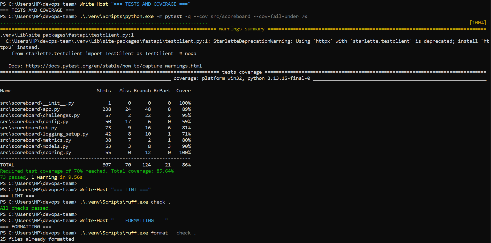
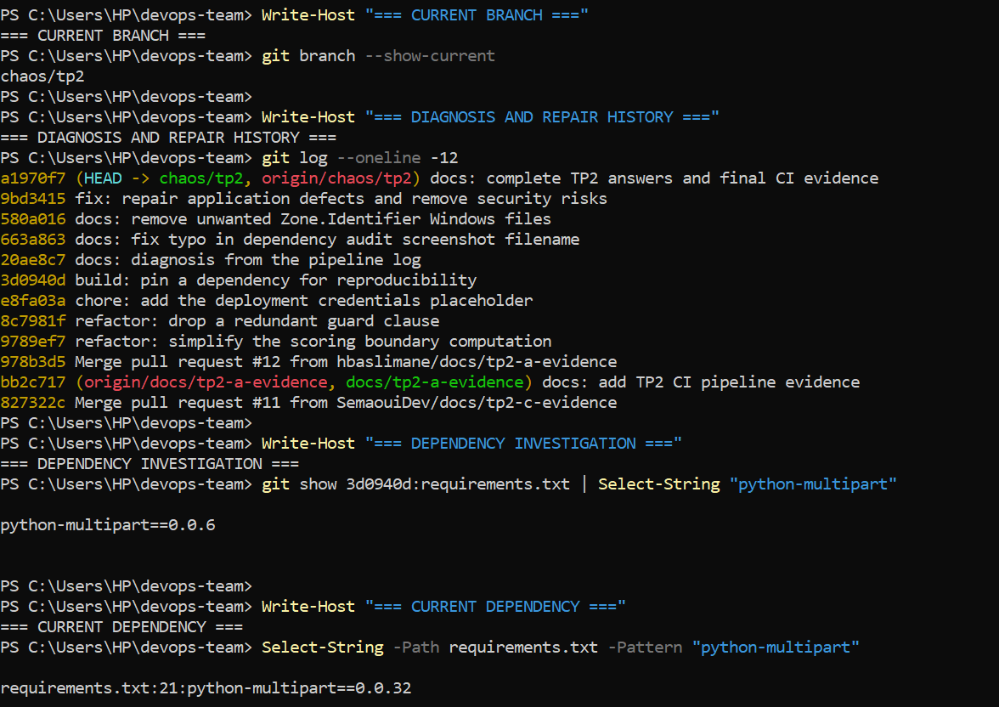
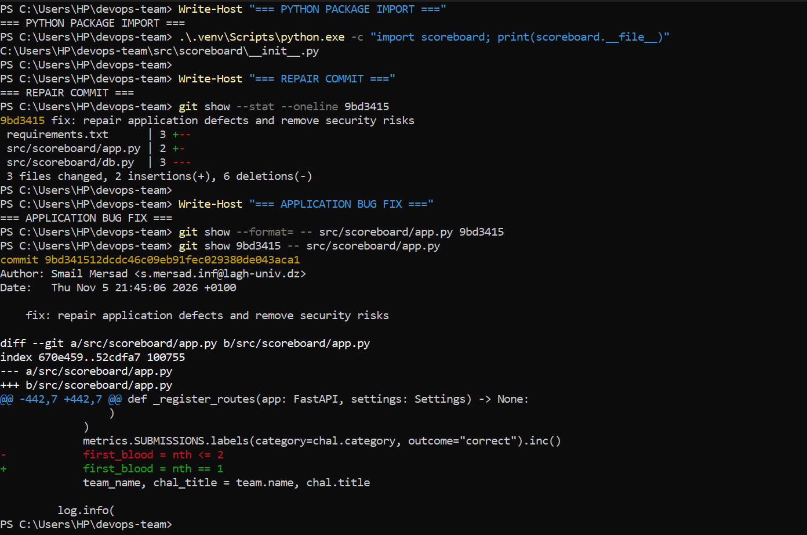

# Lab Sheet 2 — Continuous Integration

## Exercises 1–5: Answers and Evidence

**Project:** CTF Scoreboard

**Course:** DevOps

**Repository:** [hbaslimane/devops-project](https://github.com/hbaslimane/devops-project)

**Team members:**

- Hadj Aissa BASLIMANE	username: hbaslimane

- Smail MERSAD	username: falconMer

- Ahmed SEMAOUI	username: SemaouiDev

- Aoumeur TIRICHINE	username: aoumeurtiri

---

## Exercise 1 — The CI Pipeline

### 1(a) What does pull_request provide that push cannot?

The `pull_request` event allows us to verify proposed changes before merging them into `main`. It provides feedback on the incoming code and enables branch protection to prevent merging when required checks fail.

### 1(b) Why does lint run before tests?

I placed lint before tests because linting is generally faster and less expensive. It detects formatting and code-quality issues early, allowing us to identify simple problems before examining more expensive checks.

### 1(c) Why is the order more important for a 20-minute test suite?

When tests take 20 minutes, performing inexpensive checks first provides faster feedback. In a pipeline that stops after failure, this also avoids unnecessary test execution. Our workflow intentionally uses `if: ${{ !cancelled() }}` on later gates, so those gates continue after earlier failures to provide a complete diagnostic report.

### Implementation and result

I created `.github/workflows/ci.yml` with the required five verification gates:

1. Install

2. Lint

3. Tests with at least 70% coverage

4. Secret scanning using Gitleaks

5. Dependency auditing using pip-audit

I submitted the workflow through PR #6, which was successfully merged into `main`. The `verify` job passed.

**Evidence — Successful CI pipeline**

---

## Exercise 2 — Branch Protection

### 2(a) Which command skips a pre-commit hook?

The command `git commit --no-verify -m "message"` bypasses pre-commit and commit-msg hooks.

This demonstrates why local hooks alone cannot guarantee that every contributor performs security checks.

### 2(b) Who can still put a detected secret on main?

With the required `verify` check enforced, ordinary contributors cannot merge a Pull Request whose pipeline fails.

However, someone with permission to bypass or modify branch protection, such as an administrator who can change the repository rules, could potentially circumvent this restriction.

### Configuration and result

Our repository owner configured the active `Protect main` ruleset. It targets `main`, requires the `verify` status check, and requires Pull Request approval.

**Evidence — Before configuration**

**Evidence — Required verify check**

**Evidence — Rule targeting main**

**Evidence — Saved ruleset**

---

## Exercise 3 — Importance of Installation

### 3(a) Copy the error line from the pipeline log.

The failed pipeline reported:

`ModuleNotFoundError: No module named 'scoreboard'`

It occurred while importing `tests/conftest.py`.

### 3(b) Explain the failure using the term src layout.

The project follows a `src` layout, meaning that the Python package is located inside `src/scoreboard` rather than directly at the repository root.

Without `pip install -e .`, Python may not be able to locate and import the `scoreboard` package in the clean GitHub Actions environment.

Therefore, installing the development dependencies alone was insufficient.

### 3(c) Which command ran pip install -e . automatically?

The command `make install` runs the editable installation as part of its Makefile recipe.

On our Windows machines, we also performed the equivalent installation manually using Python and pip.

### Experiment and result

Our team created the temporary `experiment/no-install` branch and removed `pip install -e .` from the workflow.

We opened PR #9 and observed the expected import failure in GitHub Actions.

After collecting the evidence, we closed the PR without merging the broken workflow into `main`.

**Evidence — Failed CI pipeline**

**Evidence — Import error**

---

## Exercise 4 — Diagnose the Four Seeded Defects

Our team created `chaos/tp2`, executed the provided seeding script, and investigated the resulting failed pipeline.

We examined the pipeline logs before inspecting the application code and committed the observations to `docs/TP2_diagnosis.md`.

### Findings from the pipeline logs

| Defect | Failed gate | Name or result in log | Cause |

|---|---|---|---|

| Test 1 | tests | `test_the_second_solver_is_not` | Assertion failed: `assert True is False` |

| Test 2 | tests | No second failure reported | No independent failure appeared in the log |

| Credential | secret scan | `leaks found: 1` | A hardcoded credential was detected |

| Dependency | dependency audit | `python-multipart 0.0.6` | The audit reported 16 vulnerability findings |

### Test failure classification

**Test 1:** Assertion failure.

**Test 2:** No second test failure was reported, so we cannot classify it as an assertion or exception failure.

The failed run reported **1 failed test and 72 passed tests**.

### Additional observation after committing the diagnosis

During the later repair phase, we inspected the seeded changes and found that two consecutive commits in `src/scoreboard/challenges.py` canceled each other: one duplicated a guard clause, and the next removed that duplication.

Consequently, that intended defect left no effective code change and did not produce an independent failing test.

This finding was discovered after the initial log-based diagnosis, not during it.

### Evidence

**Failing tests**

**Secret scanning**

**Dependency audit**

The original diagnosis is preserved in `docs/TP2_diagnosis.md`, committed before the repair commit.

---

## Exercise 5 — Repair the Defects

### Application code repair

I examined the changes in `src/scoreboard/app.py`.

The injected condition was:

`first_blood = nth <= 2`

This incorrectly identified the first two teams solving a challenge as achieving first blood.

I restored the correct condition:

`first_blood = nth == 1`

Only the first successful solver should receive first-blood status.

I did not modify any test files.

### Secret removal

I removed the injected hardcoded `SNAPSHOT_ACCESS_KEY` from `src/scoreboard/db.py`, along with its associated comment.

This eliminated the credential detected by the secret-scanning gate.

### Dependency repair

I restored `requirements.txt` from the clean `main` branch, replacing the injected vulnerable version of `python-multipart` with the original dependency specification.

### 5(a) Is the vulnerable package direct or transitive?

The vulnerable `python-multipart` package was a **direct dependency**, because the seeded version `python-multipart==0.0.6` was explicitly listed in `requirements.txt`.

### 5(b) How did you find out? Give the command.

I inspected the dependency manifest in the seeded commit using:

`git show 3d0940d:requirements.txt | Select-String "python-multipart"`

The output identified the package as an explicit dependency.

### Final verification

After completing the repairs, I ran the local tests and Ruff checks.

The local results were:

- 73 tests passed.

- Ruff lint passed.

- Ruff formatting passed.

- No Git whitespace errors.

I committed the repairs in commit `9bd3415`, after the diagnosis commit.

After pushing the fixes to PR #13, GitHub Actions completed successfully. All five verification gates passed.

**Evidence — Successful repaired pipeline**

---

## Local Command Execution Evidence

**Note about the screenshot evidence:** Initially, our team understood the screenshot requirement as documenting the results of each exercise, particularly the GitHub Actions pipeline and its failures. Consequently, we captured the CI results and other evidence but did not take screenshots of every command executed locally during the original lab.

After reading the Classroom clarification, I re-ran the relevant non-destructive verification commands and captured their actual outputs in `docs/screenshots/`. The original work is also documented through Git commit history, pull requests, and GitHub Actions logs.

I captured screenshots of my local PowerShell commands and their outputs to document the verification of Lab 2.

### Tests, Coverage, and Lint

I ran the pytest suite with the required 70% minimum coverage, followed by the Ruff lint and formatting checks.

The results were 73 passed tests, 85.64% coverage, successful linting, and 25 correctly formatted files.

### Git History and Dependency Investigation

I verified the diagnosis-before-repair commit order using Git history. I also inspected the vulnerable dependency in the seeded commit and confirmed its restored version in requirements.txt.

### Package Installation and Application Repairs

I performed local verification of the Python package and inspected the repair commit to document the application changes.

---
## Conclusion

Through this lab, our team implemented and enforced a five-gate CI pipeline, demonstrated why editable package installation matters, and used pipeline logs to investigate intentionally introduced defects.

I repaired the application logic, removed the hardcoded credential, and restored the dependency specification without modifying the tests.

The final successful run demonstrates that the CI pipeline can detect defects and verify their repairs.

The Git history preserves the original diagnosis commit before the repair commit, as required by the lab instructions.

