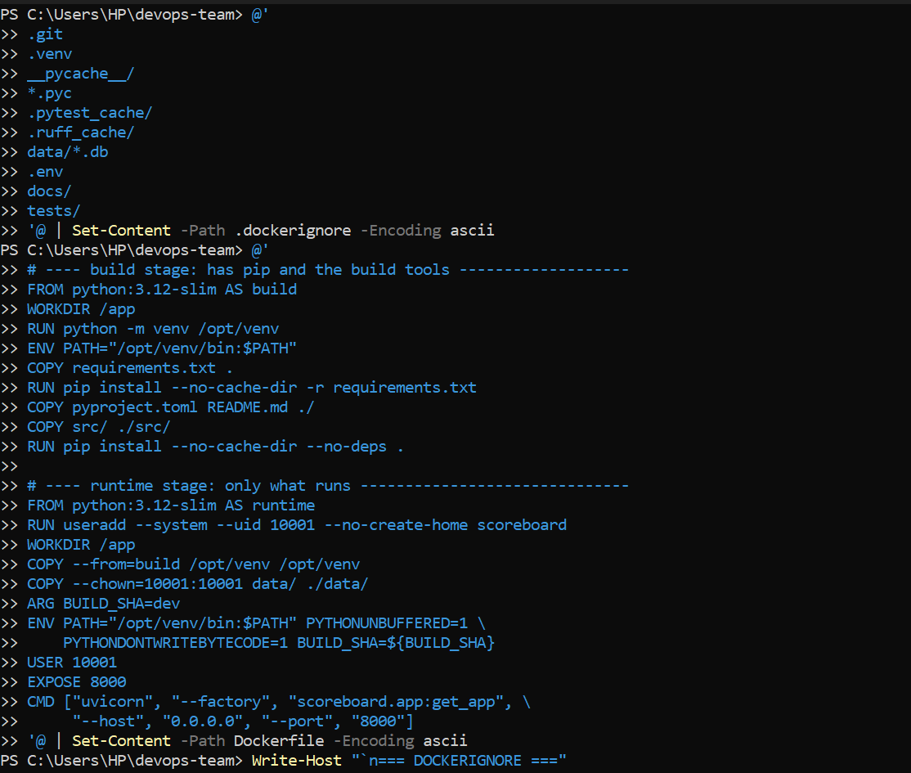
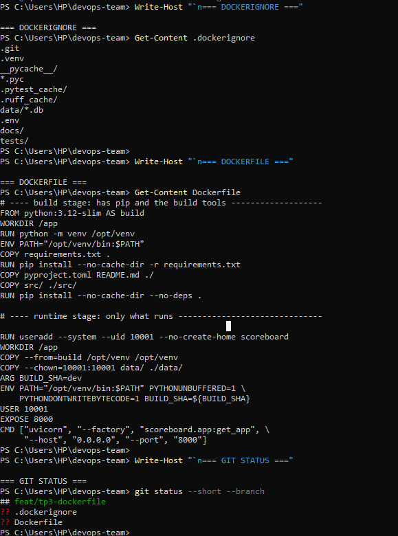
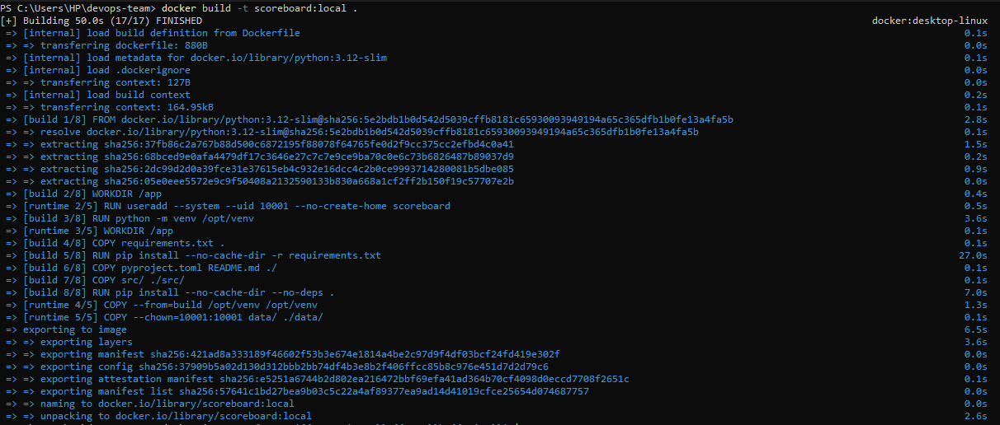
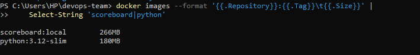
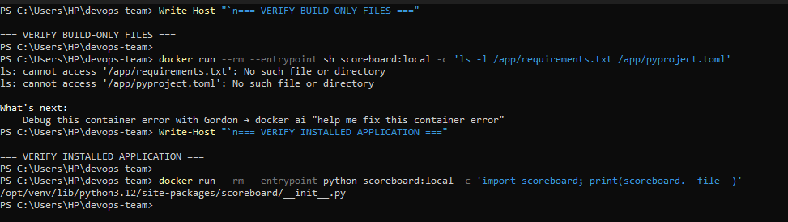
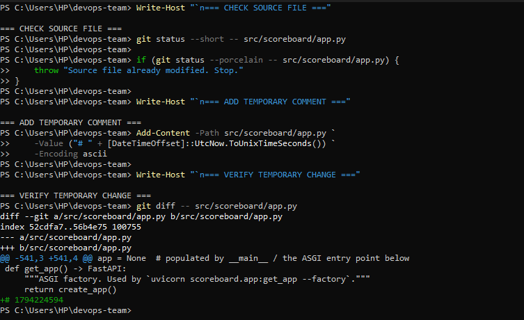
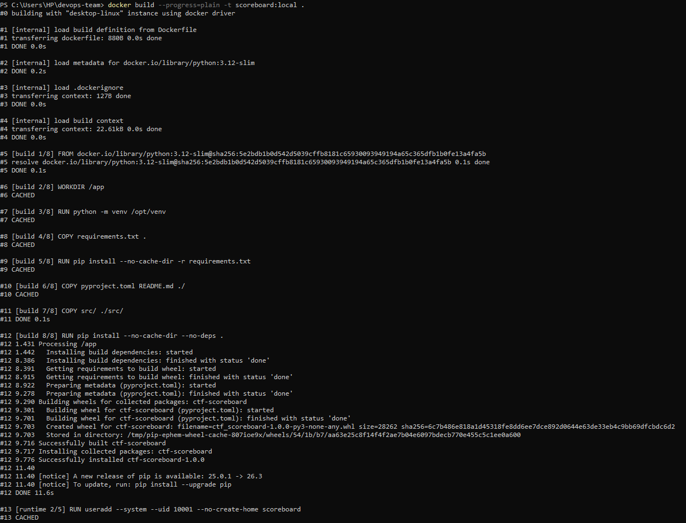
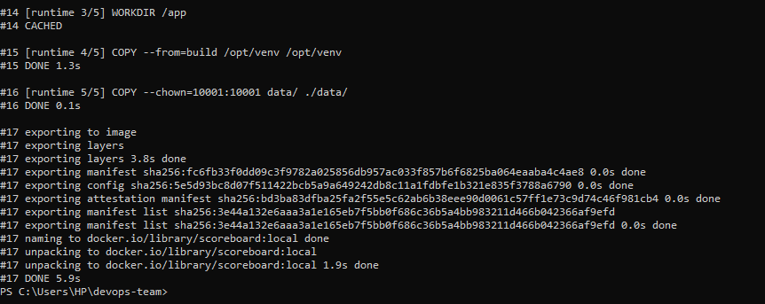
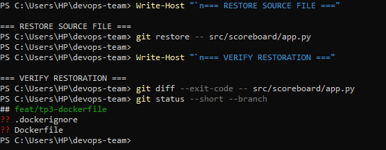

# TP3 - Containers

## Team Members

- Smail MERSAD (`falconMer`)
- Hadj Aissa BASLIMANE (`hbaslimane`)
- Ahmed SEMAOUI (`SemaouiDev`)
- Aoumeur TIRICHINE (`aoumeurtiri`)

## Part A: A Multi-Stage Image

I created `.dockerignore` and the two-stage `Dockerfile` specified in the lab. The build stage installs the Python dependencies and application into a virtual environment. The runtime stage copies the installed environment, includes the application data, and runs the service under the non-root user ID `10001`.

I built the image with `docker build -t scoreboard:local .`, and Docker reported that the build completed successfully.

### Exercise 1

**(a) Give the size of `scoreboard:local` and `python:3.12-slim`.**

I listed the images with the PowerShell equivalent of the lab's `docker images` command and measured the following sizes:

| Image | Displayed size |
|---|---:|
| `scoreboard:local` | 266 MB |
| `python:3.12-slim` | 180 MB |

The application image is 86 MB larger because it adds the installed application and its runtime dependencies to the Python base image.

**(b) Name two things that are in the build stage but not in the runtime image.**

Two examples are `requirements.txt`, used during dependency installation, and `pyproject.toml`, used for project metadata and installation configuration. I checked the runtime image directly: both files were absent from `/app`, while the `scoreboard` Python package was present in the installed virtual environment.

**(c) For each of these two things, explain why its absence makes the image more secure.**

- **`requirements.txt`:** Excluding the manifest avoids shipping an unnecessary list of dependency names and exact versions as a separate runtime file. It modestly limits information available for reconnaissance, although installed packages can still be inspected.
- **`pyproject.toml`:** Excluding project metadata and build configuration removes files that the running service does not need and reduces the amount of build-related information exposed in the container.

These are modest information-exposure reductions, not guarantees against exploitation. The installed dependencies still need to be scanned and maintained.

**(d) Why does `COPY requirements.txt` come before `COPY src/`? Use what the second build printed.**

Docker caches layers when the instructions and their inputs are unchanged. After I added a temporary timestamp comment to `src/scoreboard/app.py`, the second build reported `CACHED` for `COPY requirements.txt` and `RUN pip install --no-cache-dir -r requirements.txt`, among other unchanged steps. Docker reran `COPY src/` and `RUN pip install --no-cache-dir --no-deps .` because the application source had changed. Thus, putting dependency installation before source copying avoids needlessly reinstalling unchanged dependencies on source-only edits.

After the experiment, I restored `src/scoreboard/app.py` to its original state and verified that no source-file changes remained.

<!-- Parts B-E and Exercises 2-5 will be added after the team's actual experiments. -->
