# TP3 - Containers

## Team Members

- Smail MERSAD (`falconMer`)
- Hadj Aissa BASLIMANE (`hbaslimane`)
- Ahmed SEMAOUI (`SemaouiDev`)
- Aoumeur TIRICHINE (`aoumeurtiri`)

## Part A: A Multi-Stage Image

We created `.dockerignore` and the two-stage `Dockerfile` specified in the lab. The build stage installs the Python dependencies and application into a virtual environment. The runtime stage copies the installed environment, includes the application data, and runs the service under the non-root user ID `10001`.

We built the image with `docker build -t scoreboard:local .`, and Docker reported that the build completed successfully.

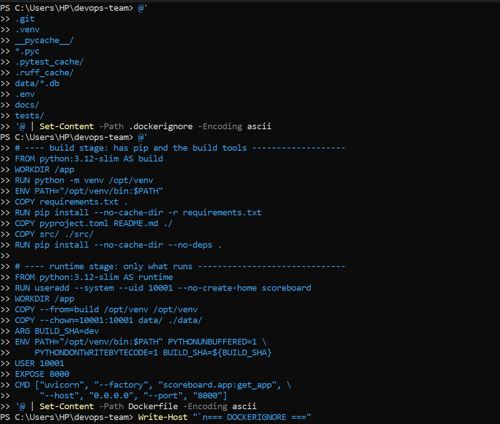

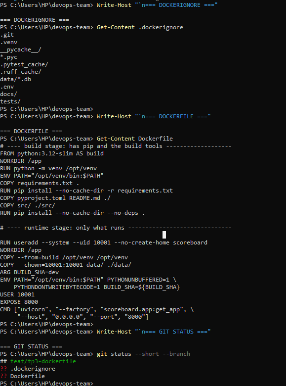

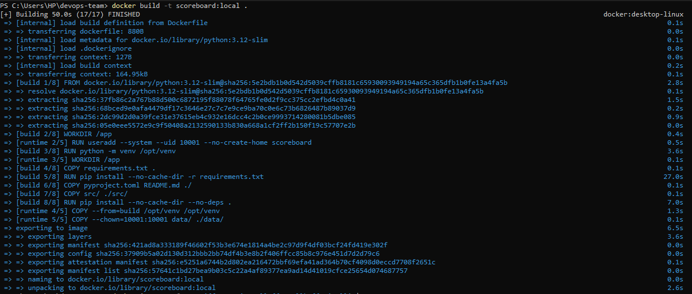

### Exercise 1

**(a) Give the size of `scoreboard:local` and `python:3.12-slim`.**

We listed the images with the PowerShell equivalent of the lab's `docker images` command and measured the following sizes:

| Image | Displayed size |
|---|---:|
| `scoreboard:local` | 266 MB |
| `python:3.12-slim` | 180 MB |

The application image is 86 MB larger because it adds the installed application and its runtime dependencies to the Python base image.

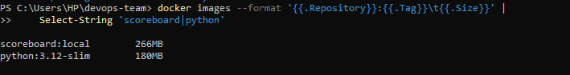

**(b) Name two things that are in the build stage but not in the runtime image.**

Two examples are `requirements.txt`, used during dependency installation, and `pyproject.toml`, used for project metadata and installation configuration. We checked the runtime image directly: both files were absent from `/app`, while the `scoreboard` Python package was present in the installed virtual environment.

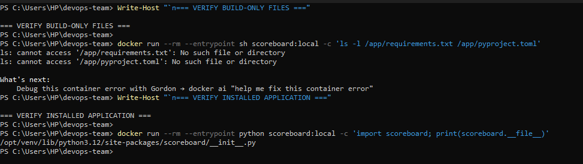

**(c) For each of these two things, explain why its absence makes the image more secure.**

- **`requirements.txt`:** Excluding the manifest avoids shipping an unnecessary list of dependency names and exact versions as a separate runtime file. It modestly limits information available for reconnaissance, although installed packages can still be inspected.
- **`pyproject.toml`:** Excluding project metadata and build configuration removes files that the running service does not need and reduces the amount of build-related information exposed in the container.

These are modest information-exposure reductions, not guarantees against exploitation. The installed dependencies still need to be scanned and maintained.

**(d) Why does `COPY requirements.txt` come before `COPY src/`? Use what the second build printed.**

Docker caches layers when the instructions and their inputs are unchanged. After we added a temporary timestamp comment to `src/scoreboard/app.py`, the second build reported `CACHED` for `COPY requirements.txt` and `RUN pip install --no-cache-dir -r requirements.txt`, among other unchanged steps. Docker reran `COPY src/` and `RUN pip install --no-cache-dir --no-deps .` because the application source had changed. Thus, putting dependency installation before source copying avoids needlessly reinstalling unchanged dependencies on source-only edits.

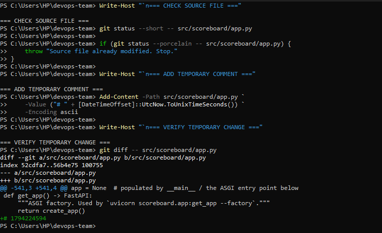

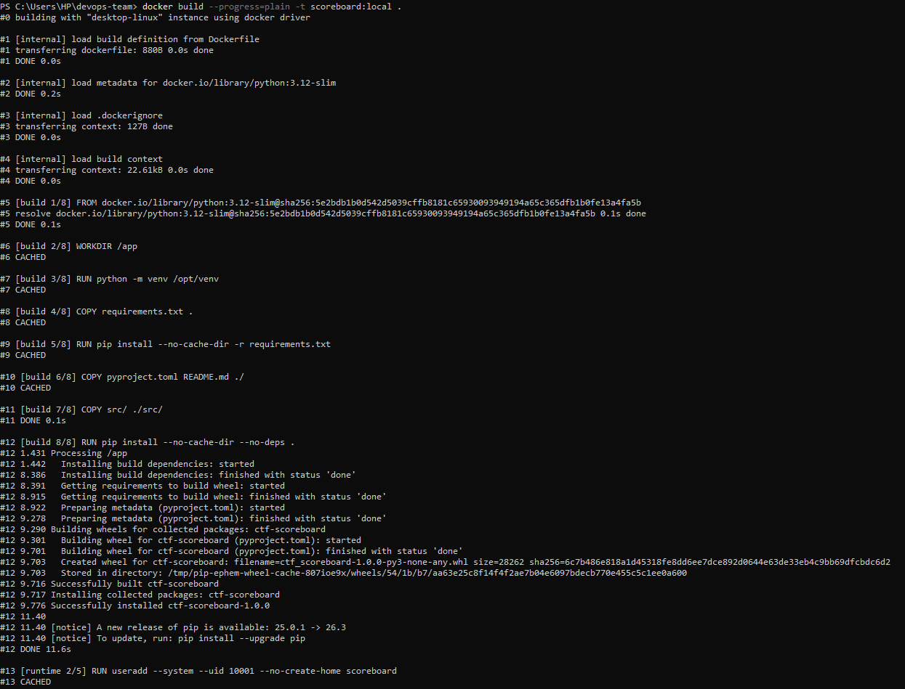

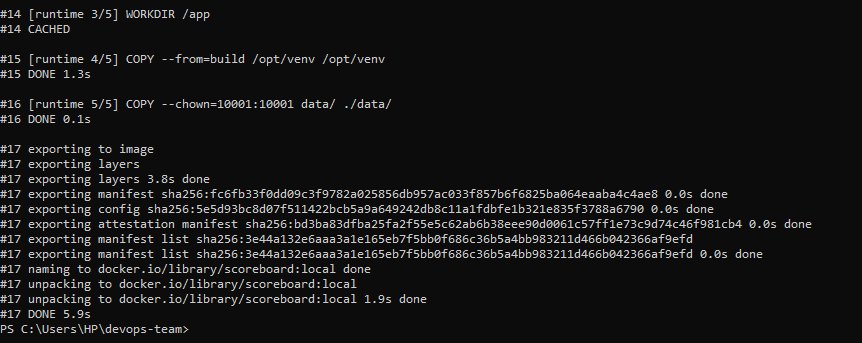

After the experiment, we restored `src/scoreboard/app.py` to its original state and verified that no source-file changes remained.

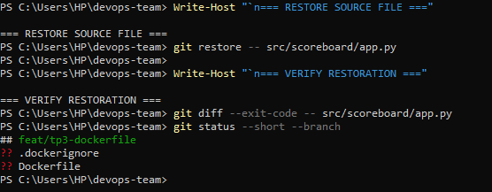

## Part B: Run It with the Minimum It Needs

We ran the application in the hardened container prescribed by the lab: a read-only root filesystem, writable `/tmp` tmpfs, all Linux capabilities dropped, no-new-privileges, CPU and memory limits, and a Docker-managed volume for the database. The container's end-to-end smoke test passed all 12 checks and ended with `all good`. Its local build reported version commit `dev`, as expected before pipeline publishing.

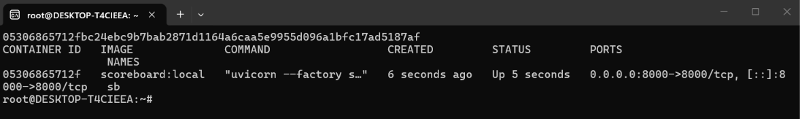

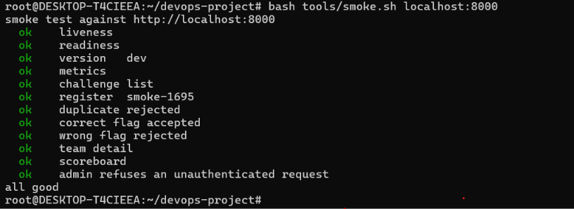

We verified that `docker exec sb id` reported `uid=10001(scoreboard) gid=999(scoreboard)` and that creating `/app/x` failed with `Read-only file system`.

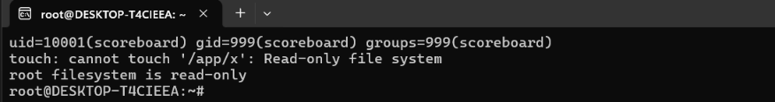

### Exercise 2

**(a) Which mount lets SQLite write when the root filesystem is read-only?**

The named volume `-v sbdata:/app/data` provides a separate writable mount for SQLite database files, even when the container's root filesystem is read-only. The `--tmpfs /tmp` mount separately permits temporary writes under `/tmp`.

**(b) Why use the named volume `sbdata` instead of binding `$PWD/data`?**

A named volume is managed by Docker and does not depend on a particular host directory path or its existing file ownership. A bind mount of `$PWD/data` depends on a host path whose permissions may not match the container's non-root UID `10001`; it also exposes that host directory's files directly to the container. A named volume offers better portability and a narrower host-filesystem interface, though its stored data remains writable by the service.

**(c) Choose two other hardening options. What can an attacker no longer do?**

- **`--cap-drop ALL`:** A compromised process cannot use Linux capabilities such as `CAP_CHOWN` or `CAP_NET_RAW`, preventing privileged operations such as arbitrarily changing file ownership or opening raw sockets through those capabilities.
- **`--security-opt no-new-privileges`:** The process cannot acquire additional privileges by executing a setuid program or using file capabilities. This limits privilege escalation through those mechanisms; it does not eliminate every possible vulnerability.

## Part C: Who Receives SIGTERM?

We compared two container entry points: `sb`, in which uvicorn runs as PID 1, and `sb2`, in which a shell (`sh -c`) runs as PID 1 and launches Python as a child process. We measured the stop times and inspected `/proc/1/cmdline` to identify the process receiving Docker's stop signal.

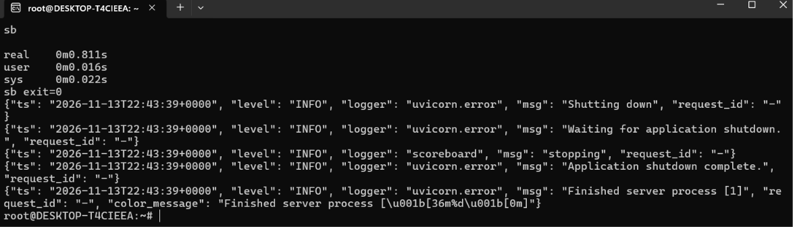

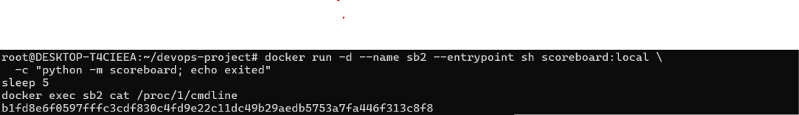

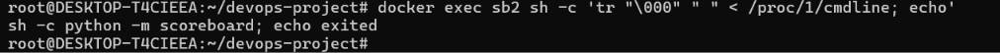

### Exercise 3

**(a) Give both stop times.**

| Experiment | `sb` (uvicorn as PID 1) | `sb2` (shell as PID 1) |
|---|---:|---:|
| Initial stop | 0.98 s, exit code 0 | 3.40 s, exit code 137 |
| Control with `docker stop -t 30` | 1.02 s, exit code 0 | 30.33 s, exit code 137 |

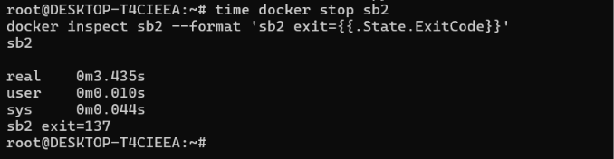

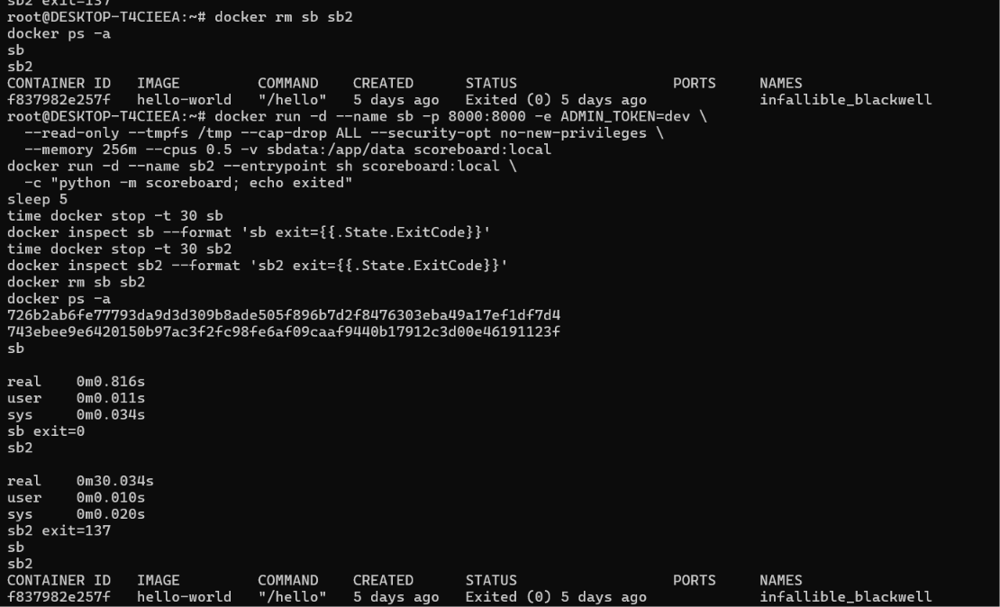

**(b) Explain the difference using PID 1 and SIGTERM.**

`docker stop` sends `SIGTERM` to PID 1. In `sb`, uvicorn is PID 1: it handles `SIGTERM`, performs a clean shutdown and exits with code 0. In `sb2`, `sh` is PID 1 and starts Python as a child; in this experiment, the shell did not forward `SIGTERM` or shut down on that signal. After the grace period, Docker terminated the container with `SIGKILL` (exit code 137). The `-t 30` control run supports this explanation: the shell-based container took approximately 30 seconds to stop, while uvicorn still exited promptly.

**(c) What does this difference cost when twenty replicas are replaced sequentially?**

Using the initial measured times, the extra stop delay is `3.40 - 0.98 = 2.42 s` per replica, or about `20 x 2.42 = 48.4 s` for twenty sequential replacements. Under the 30-second control condition, the measured difference is `30.33 - 1.02 = 29.31 s`, or about `586.2 s` (9 min 46 s) over twenty replicas. These estimates assume sequential replacements, similar stop behavior for every replica, and no additional startup time. The precise penalty depends on the configured termination grace period and actual container behavior.

After the experiments, we removed the two test containers.

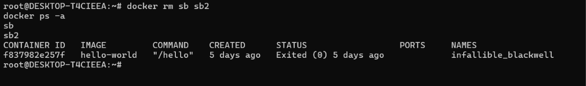

## Part D: Scan the Image

We performed Part D using the version-pinned `aquasec/trivy:0.75.0` scanner. The lab requires saving the local image as a tar archive and scanning that saved image with `--severity HIGH,CRITICAL --ignore-unfixed`. This is an image-level scan, so it covers relevant operating-system packages in addition to application dependencies.

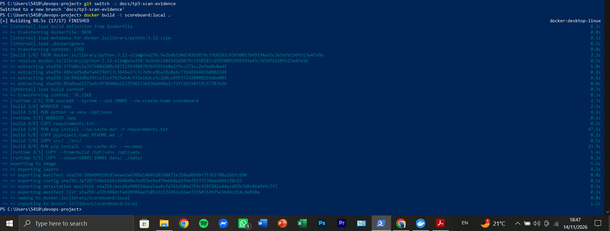

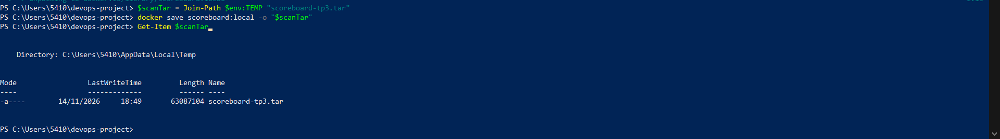

### Exercise 4

**(a) How many findings are there, and in which packages?**

In our Trivy scan output, we found **2 HIGH findings and 0 CRITICAL findings**. Both findings concerned the Debian system package **`zlib1g`**:

| Severity | Vulnerability | Affected package |
|---|---|---|
| HIGH | `CVE-2026-76844` | `zlib1g` |
| HIGH | `CVE-2026-85091` | `zlib1g` |

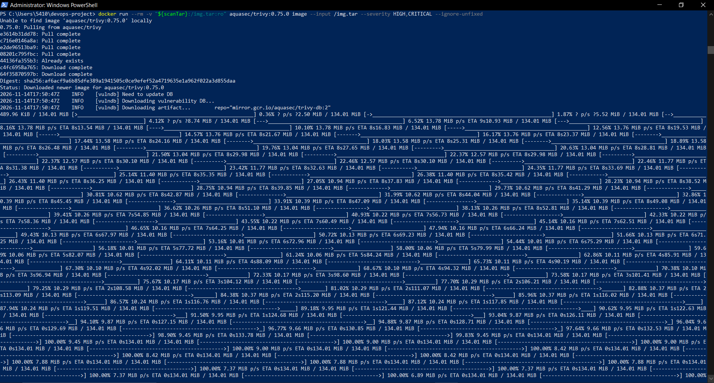

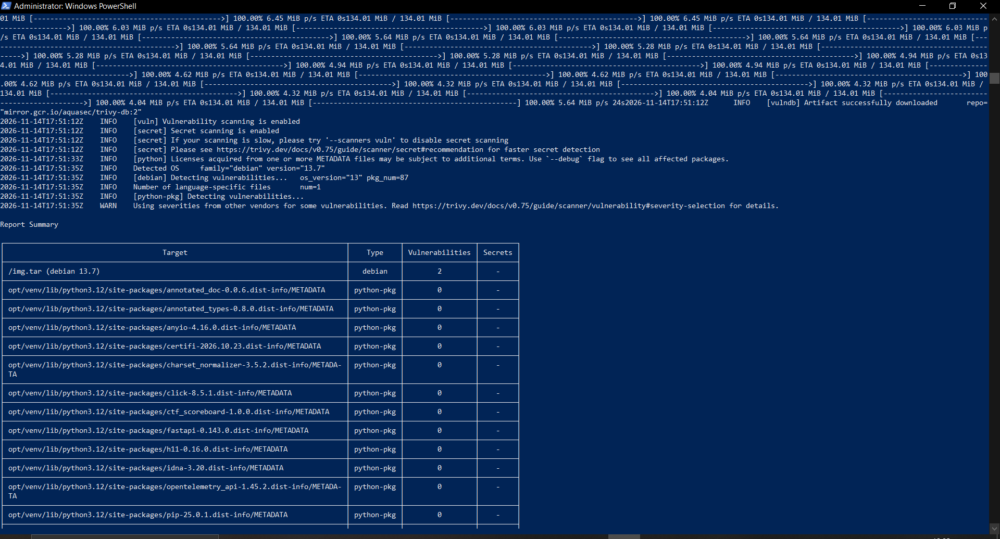

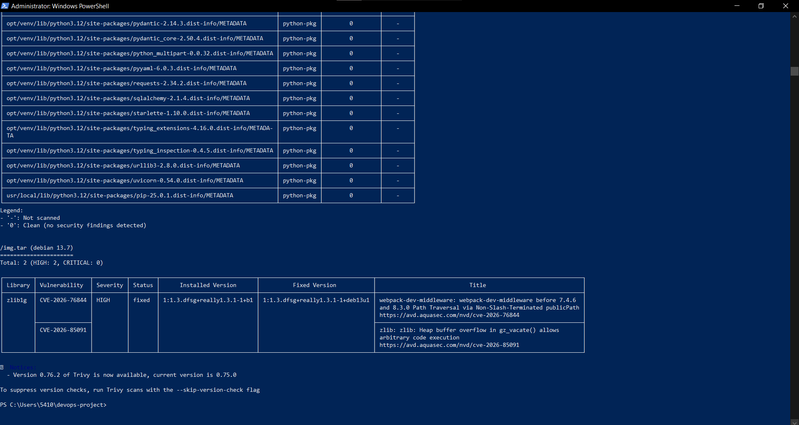

**(b) Why did `pip-audit` find no vulnerabilities in Lab 2 while Trivy found these issues?**

The Lab 2 `pip-audit` step examined **Python package dependencies** recorded in or resolved from the Python requirements. It did not scan the Linux operating-system packages installed in the container image. In contrast, Trivy examined the saved container image, including its Debian base-image packages, and reported two vulnerabilities in the OS package `zlib1g`. Therefore, a clean Python dependency audit does not mean the entire container image has no vulnerabilities.

**(c) In two lines, why is the scanner pinned to a fixed version?**

Pinning Trivy to `0.75.0` makes the scanning tool version consistent across machines and pipeline runs, supporting reproducibility. It also avoids unexpected tool-behavior changes from automatic scanner upgrades; vulnerability database updates may still change findings.

## Part E: Build and Publish from the Pipeline

We added the `image` job to `.github/workflows/ci.yml` through PR #18. The job depends on `verify`, runs on pushes to `main` (not on pull requests), and builds and publishes the image to GitHub Container Registry (GHCR). The image name is lowercased and the image tag is the full Git commit SHA. The GitHub Actions run for the merge of PR #18 completed successfully, including both `verify` and `image` jobs.

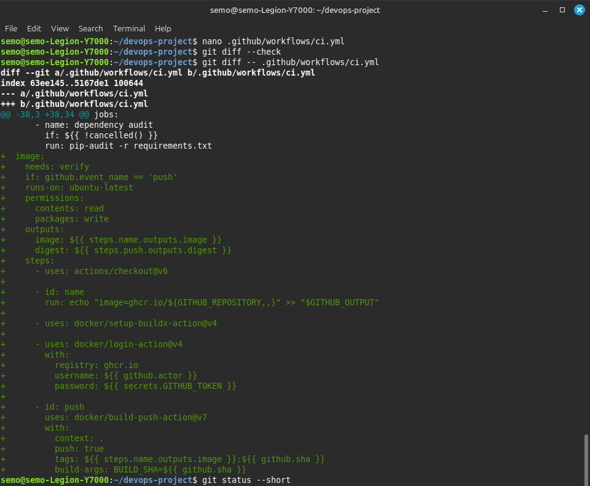

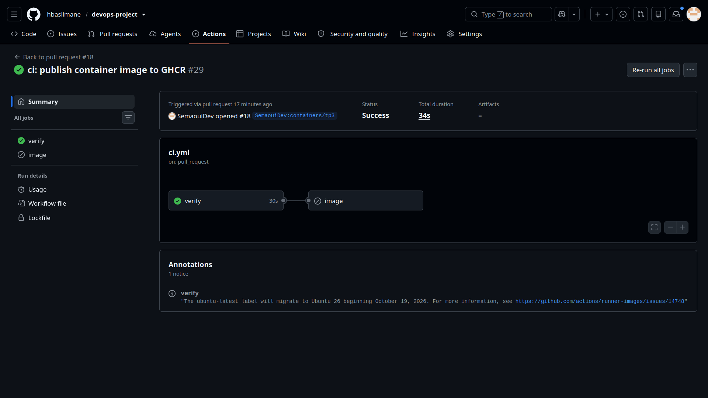

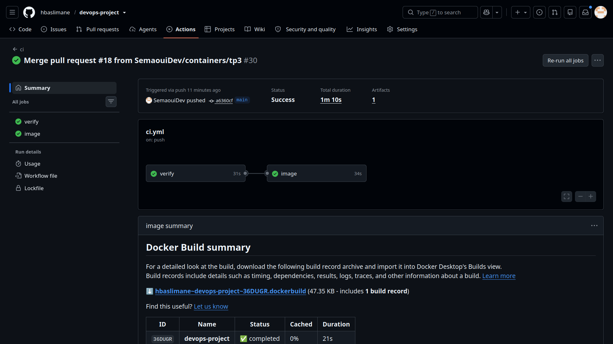

We also captured screenshots showing the GHCR package's public visibility and the published application's `/version` response. These screenshots were merged into `main` through PR #19.

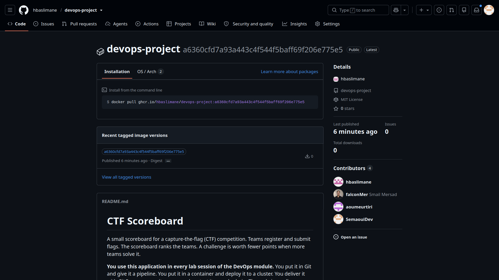

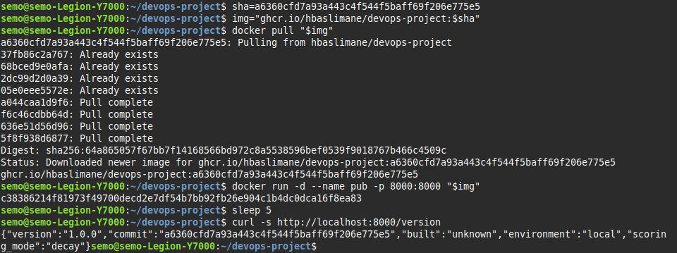

### Exercise 5

**(a) The commit identifier travels from Git to the running process. Name the different steps.**

1. The workflow obtains the Git commit SHA from the GitHub Actions context, `${{ github.sha }}`.
2. `docker/build-push-action@v7` uses that full SHA in the GHCR image tag and passes it as a build argument: `BUILD_SHA=${{ github.sha }}`.
3. The Dockerfile declares `ARG BUILD_SHA=dev` and sets `ENV BUILD_SHA=${BUILD_SHA}` in the runtime image.
4. When the container starts, the application reads `BUILD_SHA` using `Settings.from_env()`.
5. The HTTP `GET /version` endpoint returns the value in its `commit` field, allowing us to identify which Git revision is running.

**(b) Two application versions run at the same time. What concrete problem arises if both images use the tag `latest`?**

The `latest` tag is mutable: it can be repointed to a newer image without changing its name. For example, a rolling update may leave one replica running the previous image while a restarted replica pulls a different image under the same `latest` tag. Both appear to use `latest`, making the deployed versions ambiguous and rollbacks difficult to reproduce. Tagging each image with a full commit SHA makes its intended source revision traceable; a digest is needed to pin the exact image bytes.
